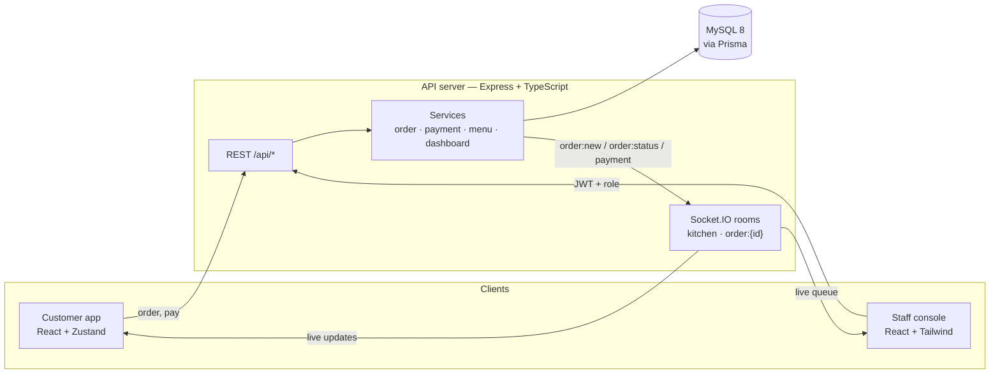

# BizFlow — QR Table Ordering & Restaurant Operations

**Customers scan a QR code at their table, order from their phone and pay with a PromptPay QR. The kitchen and cashier see every order update live.**


[](https://github.com/tawan230666/bizflow-monorepo-demo/actions/workflows/ci.yml)

---

## The problem

Small Thai restaurants lose time and money on paper order slips: orders get misheard, the kitchen has no queue, and staff walk back and forth to confirm bank transfers. BizFlow replaces that loop with three connected apps that share one real-time backend.

| App | Who uses it | What it does |
|---|---|---|
| **Customer app** | Diners, on their phone | Scan the table QR → browse menu → customise (size, toppings) → order → follow status live → pay by PromptPay QR |
| **Staff console** | Manager, kitchen, cashier | Role-based login. Kitchen display with live order queue, cashier screen to confirm payment, menu management, daily dashboard |
| **API server** | — | REST API + Socket.IO events, JWT auth with roles, Prisma/MySQL, PromptPay QR generation |

## Architecture



**Order lifecycle:** `pending → cooking → served → paid`. Each transition is pushed over Socket.IO: the kitchen room sees every order, and each customer only joins the room for their own order.

## Engineering highlights

- **Server-side pricing.** Order totals and PromptPay amounts are always recomputed from database prices and selected options. Anything the client says about price is ignored, so a tampered request can't change the bill.
- **Role-based access control.** JWT carries `admin | kitchen | cashier`, and a `requireRole()` middleware guards each endpoint. For example, only admin/cashier can mark a payment as paid.
- **Transactional writes.** Creating an order and marking its table occupied happen in one Prisma transaction, as do confirming a payment and freeing the table.
- **Idempotent payments.** Requesting a PromptPay QR twice reuses the pending payment instead of creating duplicates.
- **Layered backend.** Routes → controllers → services → Prisma, with typed errors (`HttpError`) mapped to status codes in one error handler. Internal errors are never leaked in production.
- **Real PromptPay QR.** The payload is generated to the Thai PromptPay (EMVCo) standard, so any Thai banking app can scan it.

## Tech stack

| Layer | Technology |
|---|---|
| Frontend | React 19, TypeScript, Vite, Tailwind CSS, Zustand, React Router, Recharts, Socket.IO client |
| Backend | Node.js 20, Express, TypeScript, Prisma ORM, Socket.IO, JWT, bcrypt |
| Data | MySQL 8 (schema + migrations in `apps/api-server/prisma`) |
| DevOps | Docker Compose, pnpm workspaces, tsup production bundle |

## Run it locally

**With Docker (recommended).** One command starts MySQL, runs migrations, seeds demo data and starts all apps:

```bash
git clone https://github.com/tawan230666/bizflow-monorepo-demo.git
cd bizflow-monorepo-demo
docker compose up --build
```

| URL | What |
|---|---|
| http://localhost:3003 | Customer app. Open `/table/1` to simulate scanning table 1 |
| http://localhost:4000 | Staff console |
| http://localhost:5000/api/health | API health check |

**Demo accounts (seeded):**

| Role | Username | Password |
|---|---|---|
| Manager | `admin` | `admin123` |
| Kitchen | `kitchen` | `kitchen123` |
| Cashier | `cashier` | `cashier123` |

<details>
<summary><b>Without Docker</b></summary>

Requires Node.js 20+ and a MySQL 8 database.

```bash
# API
cd apps/api-server
cp .env.example .env          # set DATABASE_URL
npm install
npx prisma migrate deploy && npx prisma db seed
npm run dev                   # http://localhost:5000

# Customer app (new terminal)
cd apps/customer-app && cp .env.example .env && npm install && npm run dev

# Staff console (new terminal)
cd apps/staff-console && cp .env.example .env && npm install && npm run dev
```
</details>

## Project structure

```
apps/
├── api-server/           Express + Prisma API, Socket.IO, PromptPay
│   ├── prisma/           schema, migrations, seed data
│   └── src/              routes → controllers → services, middlewares, sockets
├── customer-app/         Mobile-first ordering app for diners
├── staff-console/        Kitchen display, cashier, menu management, dashboard
└── franchise-dashboard/  UI prototype: multi-branch analytics (mock data)
docker-compose.yml        MySQL + API + both apps
```

## API overview

| Method | Endpoint | Auth |
|---|---|---|
| `POST` | `/api/auth/login` | — |
| `GET` | `/api/menu`, `/api/categories`, `/api/tables` | — |
| `POST` / `PUT` / `DELETE` / `PATCH` | `/api/menu`, `/api/menu/:id`, `/api/menu/:id/toggle` | admin |
| `POST` | `/api/orders` | — (price computed server-side) |
| `GET` | `/api/orders/kitchen/active` | kitchen, admin |
| `PATCH` | `/api/orders/:id/status` | kitchen, cashier, admin |
| `POST` | `/api/payments/promptpay` | — (amount from order total) |
| `PATCH` | `/api/payments/:id/paid` | cashier, admin |
| `GET` | `/api/orders`, `/api/payments` | staff |
| `GET` | `/api/dashboard/stats` | admin |

## Roadmap

- [ ] Automated tests for order pricing and payment flows (Vitest + Supertest)
- [ ] Bank slip verification instead of manual cashier confirmation
- [ ] Connect the franchise dashboard prototype to real multi-branch data


## Team

Built by **Tawan Tiphkun** ([@tawan230666](https://github.com/tawan230666)) with [@Benjasarayut](https://github.com/Benjasarayut), Software Engineering, Rajamangala University of Technology Lanna (RMUTL), Chiang Mai.
